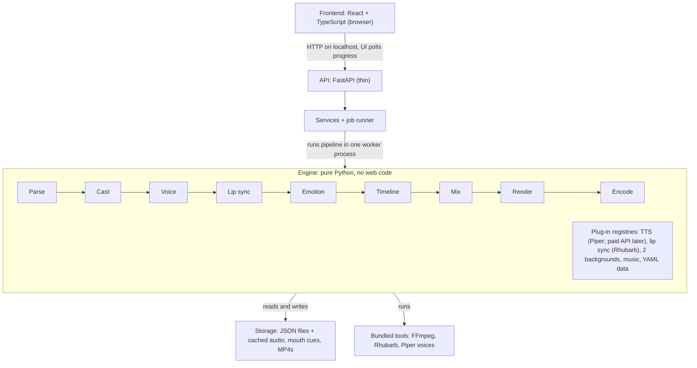

# ToonForge — PRD / MVP

Revision 2.0 (Claude layer) · Oct 17, 2026 — supersedes parts of revision 1.2 below

## 0. Revision 2.0: Claude designs and directs

Revision 1.2's fully coded, AI-free engine rated 1/10 in review: slider-built characters looked generic, expressions
barely read, nothing acted, and shots were planned by fixed rules. Revision 2.0 puts **Claude in the middle**:

- **Characters** are designed by Claude from the user's description, as layered vector puppet kits (face, eye/brow/mouth
  states, arms, hands, expressions, gestures) in the reference style (`docs/PUPPET_KIT.md`). The user revises them by
  telling Claude what to change. Sliders, keyword auto-fill and randomize are removed.
- **Backgrounds** are designed by Claude per character/scene (library or made for one video).
- **Scripts** can be written by Claude from a one-line idea (the tagged script box stays).
- **Every video is directed by Claude**: shot list, rhythm (lead-ins, reaction tails, silent beats), camera pushes,
  and each character's expressions, gestures, gaze and head moves tied to words (`docs/DIRECTION.md`).
- **Models:** Opus 5.5 leads each task and plans; it breaks complex work into simpler subtasks and assigns them to
  Sonnet 5.5 or Haiku 5.5 by complexity. Claude Code runs headless on each PC through the Claude Agent SDK.
- **Tokens:** no longer zero. Cost is not optimized yet (planned later); Claude's outputs are cached so re-renders of
  the same script reuse the direction and saved characters/backgrounds never cost again.
- **Unchanged:** Piper voices, lip sync, audio mix, deterministic frame rendering, chunked/resumable render, MP4 encode,
  projects, jobs, and the five-screen flow.

Where sections below mention sliders, keyword auto-fill, parametric parts, rule-based emotions/shots, or an AI-free
runtime, revision 2.0 replaces them.

## 1. Context & problem

ToonForge is a local, AI-free app that turns a tagged dialogue script into a production-ready 2D cartoon video with expressive, lip-synced characters.

- **Users:** content team members, each running their own install on a low-end Windows PC (4–8 GB RAM, no GPU).
- **Reference video:** 17 s, 1920×1080, 24 fps, two-character dialogue in flat 2D vector style with shot/reverse-shot close-ups.
- **Target quality:** same style, clearly better expressions, lip sync, idle motion and polish. No silent gaps.
- **Why past attempts were static:** scenes and characters were hardcoded. Here every video is assembled from data (script + character parameters + settings), with no per-video code.
- **Runtime AI:** none. Zero Claude tokens per video. Claude writes the code once.

## 2. Core principles

Every output is computed from the user's inputs; nothing in the engine knows about any specific story or character.

- **Lean first release:** the smallest set of tools that doesn't lower video quality; everything else waits for v2 (§4 lists what's deferred).
- **Data-driven, not hardcoded:** script, characters, emotions, backgrounds and keyword rules live in data (JSON/YAML), not in code.
- **Deterministic:** the same inputs + seed always produce the same video. Storyboard frames match the final render exactly.
- **AI-free runtime:** rules, parametric art and procedural generation only. TTS is the one swappable external piece.
- **Low-end first:** CPU-only, streamed frame rendering, small memory footprint. A GPU is never required.
- **Plug-in architecture:** TTS, lip sync, backgrounds, music and pipeline stages sit behind interfaces + a registry, so features are added or removed by registering or unregistering a module.
- **Cache everything:** each pipeline stage stores its output by content hash, so unchanged work (especially TTS) is never redone.

## 3. Inputs & rules

The user supplies a title, a tagged script, a cast and three settings; the video length comes from the script.

**Script format** (one line per dialogue turn; colon after the brackets):

```
JADE [angry]: You knew about this the whole time!
RON [smug]: Of course I did.
JADE [shocked, 0.8]: And you said nothing?
RON: Nobody asked.
```

- `NAME` must match a cast member (case-insensitive). Unknown names block rendering, with the line number shown.
- `[emotion]` is optional; an optional intensity 0.1–1.0 follows it. No tag means rule-based emotion (§7).
- Unknown emotion tags produce a warning and fall back to neutral.
- 2–6 speakers per script. Blank lines and lines starting with `#` are ignored (notes).

**Settings**

| Setting | Options | Default |
| --- | --- | --- |
| Aspect ratio | 16:9 (1920×1080) · 9:16 (1080×1920) | 16:9 |
| Background music | On · Off | On |
| Render quality | 1080p · 720p (faster) | 1080p |

**Length rule (MVP)**

- Video length = total spoken dialogue + fixed natural pauses (0.25–0.4 s between lines). No other silence.
- The UI shows the computed length after the voice step. Over 15:00 shows an error and blocks rendering.
- A target-length input is deferred to a later phase.

## 4. MVP scope

The MVP delivers script-to-MP4 for close-up dialogue videos; everything in the Later column waits for v2.

| Area | In MVP | Later |
| --- | --- | --- |
| Script | Tagged script in a plain text box, validation listed by line number | Free-prose input, mid-line emotion tags, syntax highlighting |
| Characters | Parametric builder with proportion sliders, keyword auto-fill, randomize, live preview; saved as JSON files (copy a file to share), snapshot per project | Full-body rigs, outfit editor |
| Art library | ~6 hair styles per gender, ~6 facial hair, 5 outfits, 2 glasses | Larger library |
| Expressions | 12 emotion presets with intensity, listener reactions, blinks, eye darts, breathing, head motion, emphasis on loud words | Per-word gaze tags |
| Shots | Three close-up sizes, reaction cutaways, push-in and punch-in with one tuned default; framing for 16:9 and 9:16 | Shot energy setting, re-roll, wider shots, hand gestures |
| Backgrounds | 2 procedural generators (office, night city) with seeded variation and depth blur | More generators, per-line locations |
| Voice | Piper (offline), auto voice by gender/age, per-character pitch and speed, emotion-based delivery | Paid TTS API (drop-in provider) |
| Lip sync | Rhubarb, phoneme-based mouth shapes from audio + text | — |
| Audio | Loudness-normalized dialogue, micro-fades between lines; music toggle with generated loop, ducked under speech | User-supplied tracks, mood selection |
| Length | Equals script length, 15:00 cap | Target-length input |
| Storyboard | Optional: 15–20 frames + preview of the first 12–15 s; skippable | Preview from any line, edit single shots |
| Render | Preflight check, chunked render that resumes after a crash, cancel | Parallel rendering, pause, queue |
| Output | MP4 (H.264 + AAC), 1080p or 720p | Thumbnail, subtitles, other formats |
| App settings | `config.yaml` file (output folder, default voices) | Settings page |

## 5. User flow (UI screens)

A project moves through five screens; step 4 can be skipped.

1. **Projects** — cards with length and status; create, duplicate, delete.
2. **Script** — title + plain script box with live validation (errors and warnings listed by line number). Settings panel: aspect ratio, music, quality.
3. **Cast** — every speaker name found in the script is listed. For each, pick a saved character or create one in the builder:
   - Description box (e.g. "old man, silver hair, blue suit, glasses") auto-fills the controls; unmatched words are listed.
   - Controls: dropdowns, proportion sliders and color pickers; Randomize button; live preview with an emotion switcher.
   - Voice: auto-picked by gender/age, pitch and speed sliders, "play sample" button.
   - Background: chosen per character, with a randomize button.
4. **Storyboard (optional)** — computed length, 15–20 frames with the line text under each, and a preview of the first 12–15 s. Buttons: Back to edit · Continue. A Skip button on screen 3 jumps straight to rendering.
5. **Render** — preflight check (cast complete, length ≤ 15:00, free disk space), progress per stage, time left, cancel; a stopped render resumes from the last finished part. The finished MP4 plays in-app with download.

Separate page: **Character library** (browse, edit, delete, import/export JSON). App settings live in `config.yaml` for now.

## 6. Generation pipeline

Nine stages turn the script into an MP4; each stage reads the previous stage's cached output, so edits only re-run what changed.

1. **Parse** — script text → validated lines (speaker, emotion, intensity, text).
2. **Cast** — speaker names → character snapshots + voice + background.
3. **Voice (TTS)** — one WAV per line with the character's pitch and speed plus emotion-based delivery; cached by hash. The 15:00 check happens here.
4. **Lip sync** — each WAV + its text → timed mouth-shape cues.
5. **Emotion resolve** — tags, or rules for untagged lines → expression targets for the speaker and reactions for the listener.
6. **Timeline** — lines placed back-to-back with natural pauses → shot list from the shot grammar (§7) + animation tracks (expression, mouth, blinks, eyes, head, camera).
7. **Audio mix** — dialogue with micro-fades between lines, loudness-normalized to −14 LUFS (YouTube's playback level); if music is on, a generated loop ducked under speech.
8. **Render** — frames drawn and streamed into the encoder in ~30 s chunks, one chunk at a time; finished chunks are kept, so a crash, sleep or cancel resumes where it stopped.
9. **Encode** — chunks joined + mixed audio → MP4.

**Storyboard mode** runs stages 1–6 for the whole script, renders 15–20 still frames, and renders only the first 12–15 s at 540p. Its TTS output is cached, so the final render reuses it.

## 7. Character, expression & scene systems

All art is vector shapes drawn by code from parameters, so any combination renders crisply at any resolution.

**Character parameters** (stored as one small JSON per character)

- Identity: name, gender, age group (child, young, adult, middle-aged, elderly).
- Proportions (continuous sliders, the main source of uniqueness): head width, jaw, chin, eye size and spacing, nose length and width, mouth width, neck, shoulders.
- Face: shape, skin tone, wrinkles (from age), blush, freckles, moles.
- Eyes and brows: eye shape, iris color, lash style, brow thickness, arch and color.
- Hair: style (~6 per gender) with length and volume sliders, color with highlight; facial hair (~6).
- Extras: glasses (2), earrings, outfit (5) with colors and tie on/off.
- Voice id with pitch and speed offsets; default background; seed.

**Keyword auto-fill** — a YAML dictionary maps phrases to parameters ("silver hair" → hair color; "old" → elderly + wrinkles; "woman" → female). It is plain matching, no AI; new words are added by editing the YAML.

**Face rig (the expressiveness upgrade)** — about 20 continuous controls instead of swapped images:

- Brows: inner raise, outer raise, lower/frown, asymmetry.
- Eyes: upper and lower lid, widen, squint, pupil position and size.
- Mouth: 9 lip-sync shapes blended with emotion (corners up/down, stretch, press).
- Cheeks raise; head tilt, turn and nod.

**Emotions** — 12 presets defined in YAML as rig values: neutral, happy, excited, sad, angry, furious, surprised, shocked, scared, smug, confused, thinking. Intensity scales the values; changes blend over 6–10 frames, never snap.

**Rules for untagged lines** — "!" raises intensity, "?" raises brows, a small word list sets emotion (e.g. "liar" → angry, "wow" → surprised), otherwise the previous emotion is kept.

**Life layer** — always on, seeded per character: blinks every 2–6 s, small eye darts, breathing, subtle head sway, brow and head emphasis on loud syllables, and a listener reaction carried into the next cut.

**Scenes** — two procedural background generators (office, night city) with seeded variation, rendered once per shot with depth blur and reused for every frame. Framing adapts to 16:9 or 9:16 automatically.

**Shot grammar (close-ups only)** — rules pick the framing for every moment, so 15 minutes never feels like one repeated shot:

- Three close-up sizes: medium close-up (default), close-up (intensity ≥ 0.6), extreme close-up (peak moments, at most once a minute).
- Reaction cutaways: lines longer than 6 s cut to the listener for 1–2 s while the audio continues; the listener reacts to the speaker's emotion.
- Camera: slow push-in, gentle drift, quick punch-in on high-intensity words.
- Cut timing and camera motion use one tuned default in the MVP; a Shot energy setting and Re-roll come later.

**Voice identity and delivery** — each character gets pitch and speed offsets, so two same-gender characters never sound alike. Emotions adjust delivery within the TTS's limits (angry: faster, louder; sad: slower, softer; excited: faster, higher).

**Character versioning** — each project stores a snapshot of its characters, so later library edits never change finished projects.

## 8. Tech stack (final)

Python does all generation and rendering; a React UI talks to it over a local API. The MVP needs 6 Python packages, 3 frontend packages and 3 bundled tools, all free and offline.

| Layer | Choice | Why |
| --- | --- | --- |
| Language | Python 3.11 + standard library (`json`, `wave`, `hashlib`, `concurrent.futures`) | Engine; the standard library covers storage, audio files, caching and background work |
| API server | FastAPI + Uvicorn (Pydantic comes with FastAPI) | Local backend; also serves the built UI |
| Storage | JSON files in `storage/` | No database to install; characters and projects are plain files |
| Background work | One worker process; the UI polls progress every second | Keeps the UI responsive without extra services |
| Data files | PyYAML | Emotions, keywords and voices live in YAML |
| 2D rendering | skia-python (CPU) | Fast anti-aliased vector drawing, gradients, blur; no browser or GPU |
| Math / animation | NumPy | Rig blending and easing |
| Video and audio | FFmpeg (bundled) | Encoding, mixing, ducking, loudness, pitch shift |
| TTS | Piper TTS + English voice files (bundled) | Free, offline, male and female voices |
| Lip sync | Rhubarb Lip Sync (bundled CLI) | Free, offline, standard mouth shapes |
| Frontend | React 18 + TypeScript + Vite | The five screens from the UI design |
| Styling | Tailwind CSS | Minimal UI without a component kit |
| Checks | pytest + Ruff | Basic tests and linting after every change |
| Packaging | Windows setup script + `start.bat` | Each team member runs locally; one-click installer later |

**Python packages:** `fastapi`, `uvicorn`, `pyyaml`, `skia-python`, `numpy`, `piper-tts` (dev only: `pytest`, `ruff`).
**Frontend packages:** `react`, `react-dom`, `tailwindcss` (build tools: Vite, TypeScript).
**Bundled tools:** FFmpeg, Rhubarb Lip Sync, Piper voice files.

**Not in the MVP (add when needed):** SQLite/SQLAlchemy/Alembic, live progress streaming (SSE), TanStack Query, shadcn/ui, CodeMirror, Vitest, mypy, pre-commit, pyttsx3.

**TTS swap path:** the TTS layer is an interface (`TTSProvider`). Adding your paid API later = one new provider file + a settings entry. Nothing else changes.

## 9. Architecture & folder structure

Three strictly separated layers (UI, thin web API, pure-Python engine) keep each feature in one folder, plugged in through a registry.



Adding a feature means adding a stage or a provider and registering it; the UI, API and other stages stay unchanged.

```
toonforge/
├─ backend/
│  ├─ app/                  # web layer (thin)
│  │  ├─ api/routers/       # projects, characters, renders
│  │  ├─ schemas/           # Pydantic request/response models
│  │  ├─ services/          # orchestration, no drawing code
│  │  ├─ jobs/              # worker process, progress status
│  │  ├─ store/             # JSON file read/write (projects, characters)
│  │  └─ core/              # config, logging, paths, errors
│  ├─ engine/               # pure Python; usable from CLI and tests
│  │  ├─ pipeline/          # Stage interface, registry, runner, cache
│  │  ├─ script/            # parser, validator
│  │  ├─ character/         # params schema, keyword matcher, parts/, rig/
│  │  ├─ expression/        # emotion resolver, blending, life layer
│  │  ├─ tts/               # TTSProvider + piper (paid API later)
│  │  ├─ lipsync/           # LipSyncProvider + rhubarb
│  │  ├─ scene/             # background generators, framing, camera
│  │  ├─ timeline/          # shots + animation tracks
│  │  ├─ audio/             # mixer, ducking, music generator
│  │  ├─ render/            # skia frame renderer, chunking
│  │  └─ encode/            # FFmpeg wrapper
│  ├─ data/                 # emotions.yaml, keywords.yaml, voices.yaml
│  ├─ cli.py                # render a script without the UI
│  └─ tests/                # unit + golden-frame tests
├─ frontend/src/
│  ├─ features/             # projects, script, cast, storyboard, render, library
│  ├─ components/           # shared UI pieces
│  └─ api/                  # small fetch client
├─ vendor/                  # ffmpeg, rhubarb, piper voices (bundled)
├─ storage/                 # user data (gitignored)
│  ├─ characters/           # one JSON per character
│  └─ projects/<id>/        # project.json, script.txt, cache/, output/
├─ config.yaml              # output folder, default voices, feature flags
└─ scripts/                 # setup_windows.ps1, start.bat
```

**Rules that keep it flexible**

- Each stage implements one interface (`run(context) -> output`); the pipeline order is a list in config.
- Providers (TTS, lip sync, backgrounds, music) register by name and are chosen in settings.
- `engine` never imports `app`; `app` never draws. The engine runs alone from `cli.py`.
- New emotions, keywords and voices are YAML edits, not code changes.
- Feature flags in config switch modules (e.g. storyboard, music) on or off without code edits.

## 10. Performance targets (low-end PCs)

The MVP must render on a 4 GB RAM, 4-core, no-GPU Windows laptop without crashing; slower is acceptable, failing is not.

| Target | Value |
| --- | --- |
| Peak RAM during render | ≤ 1.5 GB (4 GB PC) · auto-raised on 8 GB+ |
| Disk per finished minute | ≈ 15–30 MB MP4; temporary files deleted after render |
| Install size | ≤ 1.5 GB including voices, FFmpeg and Rhubarb |
| Render speed (1080p, 4 cores) | Goal ≤ 3× video length; to be measured in the Week 1 spike |
| Storyboard + preview | Goal ≤ 2 minutes for a 5-minute script, excluding first-time TTS |

**How:** frames streamed to FFmpeg (never stored), backgrounds rendered once per shot, ~30 s chunks rendered one at a time and kept until joined (so renders resume after a crash), 720p option, and cached TTS/lip-sync results. Parallel chunk rendering is a later speed-up once the spike shows where time goes.

## 11. Acceptance criteria, risks & roadmap

The MVP is done when a new team member can install it, paste any tagged script and get a polished MP4 with no manual steps.

**Acceptance criteria**

- [ ] Any valid tagged script with 2–6 speakers renders end-to-end with no code changes.
- [ ] Fuzz test: 10 randomly generated casts and scripts all render without errors (proves no hardcoding).
- [ ] No silence longer than 0.6 s anywhere in the video.
- [ ] Mouth shapes stay within 2 frames of the audio.
- [ ] Every emotion tag visibly changes the face; 3 team reviewers prefer it to the reference in a blind side-by-side.
- [ ] No shot holds longer than 8 s.
- [ ] Two same-gender characters are clearly told apart by voice.
- [ ] Final audio measures −14 LUFS ±1.
- [ ] Scripts over 15:00 are blocked with a clear error.
- [ ] Music on/off and 16:9/9:16 both work.
- [ ] Storyboard frames match the same moments in the final video.
- [ ] A render killed mid-way resumes from the last finished chunk.
- [ ] Characters are reusable across projects and importable on a teammate's PC.
- [ ] A 5-minute video renders on a 4 GB RAM PC without crashing.

**Risks**

| Risk | Mitigation |
| --- | --- |
| Code-drawn art looks generic | Art-direction review with you after the character milestone, before building the rest |
| Small art library makes characters look alike | Proportion sliders, colors and age carry the variety; add parts after launch |
| Free TTS sounds less natural than paid | Piper's best English voices for MVP; paid API is a drop-in later |
| Piper is a small neural voice model (runs offline, free, no tokens) | If you want zero neural components, add a pyttsx3 provider (Windows voices, lower quality) |
| Render too slow on 4 GB PCs | 720p option; measure in the spike; add parallel chunks if needed |
| Windows install friction (paths, antivirus) | Bundled binaries, one setup script, later a one-click installer |

**Roadmap**

1. **Spike** — one rigged face talking with Piper + Rhubarb + FFmpeg on a 4 GB PC; measure speed and RAM.
2. **Engine core** — parser, timeline, shot grammar, rig, emotions, life layer, renderer, audio mix; CLI produces MP4.
3. **Characters** — parts library, proportion sliders, keyword auto-fill, two backgrounds; art-direction review with you.
4. **UI** — the five screens from the UI design (§12), storyboard and preview, character library.
5. **Hardening** — fuzz tests, resumable render, Windows setup script, docs, team rollout.
6. **Phase 2** — paid TTS API, target-length input, shot energy + re-roll, mid-line emotion tags, more art and backgrounds, parallel rendering, wider shots, hand gestures, subtitles.

## 12. UI design & building with Claude Code

The UI is five light, minimal screens ([ToonForge UI Design](https://claude.ai/artifact/WSUkvXgB5M6ZjWPu32pxBQ)); Claude Code builds the app from this PRD plus that design, one milestone per session.

**Visual rules**

| Token | Value |
| --- | --- |
| Background | #F5F5F2 |
| Surfaces | #FFFFFF, 1 px border #E2E2DC, 12 px corners, no shadows |
| Text / muted text | #1B1C20 / #5E616B |
| Accent (only one) | #2D55E0: primary buttons, active step, selections |
| Emotion tags | #A3460B |
| Fonts | Instrument Sans (UI), JetBrains Mono (script box), bundled with the app so it works offline |
| Controls | ≥ 44 px targets; real buttons, inputs and labels; keyboard focus visible |

**Building with Claude Code**

- Put this file in the repo as `docs/PRD.md` and the design screens in `docs/ui/` (export as images).
- The design also shows a few deferred items (Shot energy, Re-roll, Pause, Settings page, tag highlighting, thumbnails); skip them in the MVP build.
- `CLAUDE.md` rules: the engine never imports the web layer; no story- or character-specific code; new emotions, keywords and voices go in YAML; every stage and provider gets tests; no new dependency without a stated reason; run Ruff and pytest before finishing.
- Work in roadmap order (§11), one milestone per session: start in plan mode, approve the plan, then build.
- Each milestone ends with a runnable demo, e.g. `python -m toonforge.cli render samples/missing_report.txt`, and you watch the output before moving on.
